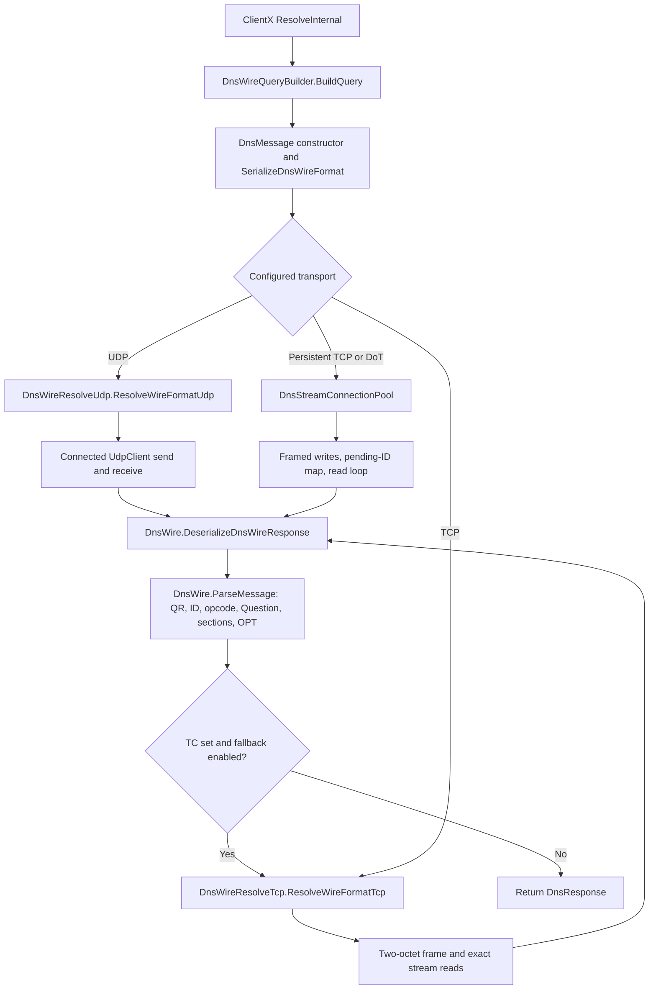

# DnsClientX 2.1.2 core DNS architecture

## Review baseline

- Review repository branch: `review/dns-core-protocol-2.1.2`, based on `81f50df3fd66ff5385b4ffdefff7e361898f4081`.
- Upstream: `EvotecIT/DnsClientX`, tag `DnsClientX-v2.1.2`, commit `1cfb438fd4c75a8ae54d457fb3073ab4aeb3718a`.
- Upstream checkout: `/workspace/DnsClientX-upstream`, outside this review repository. Its HEAD was detached at the locked commit and `git status --porcelain` was empty after inspection/build/test.
- The review checkout contains reports only; no upstream product source was copied or edited.

## Standard query path

`DnsClientX.ResolveInternal` dispatches ordinary UDP and TCP queries at `DnsClientX/DnsClientX.Resolve.cs:255-260`. `DnsWireQueryBuilder.BuildQuery` applies endpoint EDNS settings and produces one `DnsMessage` (`DnsClientX/ProtocolDnsWire/DnsWireQueryBuilder.cs:2-35`). `DnsMessage.SerializeDnsWireFormat` writes the header, one Question, and optional OPT record (`DnsClientX/ProtocolDnsWire/DnsMessage.cs:50-68,101-147`).

For UDP, `DnsWireResolveUdp.ResolveWireFormatUdp` resolves the configured server, reuses or creates a socket, sends the serialized query, parses the response against the original query, and only then evaluates TC (`DnsClientX/ProtocolDnsWire/DnsWireResolveUdp.cs:29-35,74-107`). A non-pooled socket is connected to the configured IP and port before send/receive (`:150-171`); pooled sockets are also connected on creation and keyed by remote/local endpoint (`DnsClientX/Network/DnsUdpClientPool.cs:18-43`). This lets the OS reject datagrams from a different peer. The default `Configuration.UseTcpFallback` is `true` (`DnsClientX/Configuration.cs:231-235`).

For direct TCP, `DnsWireResolveTcp.SendQueryOverTcp` writes a two-byte big-endian length followed by the query and calls `ReadExactWithTimeoutAsync` for both the response prefix and body (`DnsClientX/ProtocolDnsWire/DnsWireResolveTcp.cs:135-202,219-235`). `DnsWire.ReadExactAsync` loops until the requested count is filled and throws `EndOfStreamException` if the stream closes early (`DnsClientX/ProtocolDnsWire/DnsWire.cs:272-282`). Persistent TCP and DoT use `DnsStreamConnectionPool`: each framed query reserves its transaction ID, a reader loop consumes complete frames and routes replies by ID, and faults/disposal close the stream and release pending reservations (`DnsClientX/ProtocolDnsWire/DnsStreamConnectionPool.cs:202-255,357-407,410-469`).

## Response parsing and correlation

`DnsWire.DeserializeDnsWireResponse` funnels wire responses through `ParseMessage` (`DnsClientX/ProtocolDnsWire/DnsWire.cs:14-19,86-199`). The parser rejects messages shorter than 12 octets or longer than 65,535, checks QR, transaction ID and opcode, bounds declared section counts before allocating arrays, and requires a single matching Question (canonical name, type and class) when a request is supplied (`DnsWire.cs:86-132`). It then bounds each RR by RDLENGTH and the enclosing message/RDATA boundary, rejects trailing bytes, and formats supported RDATA types through `DnsWireRecordFormatter` (`DnsClientX/ProtocolDnsWire/DnsWire.cs:202-223`; `DnsClientX/ProtocolDnsWire/DnsWireRecordFormatter.cs`).

The transport establishes peer context before parsing: UDP uses a connected socket, and TCP/DoT read from the connection opened to the selected resolver. `DnsWire` itself validates the DNS transaction/question but does not receive a separate UDP source endpoint value.

## EDNS(0)

When EDNS is enabled, `DnsMessage` serializes one root-owner OPT record with CLASS set to the configured UDP payload size, EDNS version zero in TTL, and DO in the flags; ECS and caller-provided options are encoded in RDATA (`DnsMessage.cs:122-146`). The query builder gathers convenience options from `EdnsOptions` (`DnsWireQueryBuilder.cs:6-34`).

On receive, `DnsWire.ParseMessage` requires OPT to be in Additional, rejects duplicates and checks that the decoded owner is root. It extracts UDP size, extended RCODE, version and DO, then checks EDNS option lengths and parses ECS, Cookie, NSID and EDE (`DnsWire.cs:134-167,240-269`). The public lightweight helper `DnsWireMessageParser.TryParseEdns` separately walks the declared message to report OPT support and payload size (`DnsWireMessageParser.cs:119-184`).

## Scope boundary

This first pass examined the standard wire query path, the shared response parser, UDP/TCP transports, the persistent TCP/DoT framing implementation, and EDNS fields/options. DoH/HTTP3/gRPC/QUIC payload envelopes, multicast correlation, DNSSEC validation, TSIG, UPDATE, zone transfer, caching policy, and individual RR-type semantic validation were not reviewed in depth. Full-suite execution is evidence of regression status, not a code audit of those out-of-scope subsystems.
